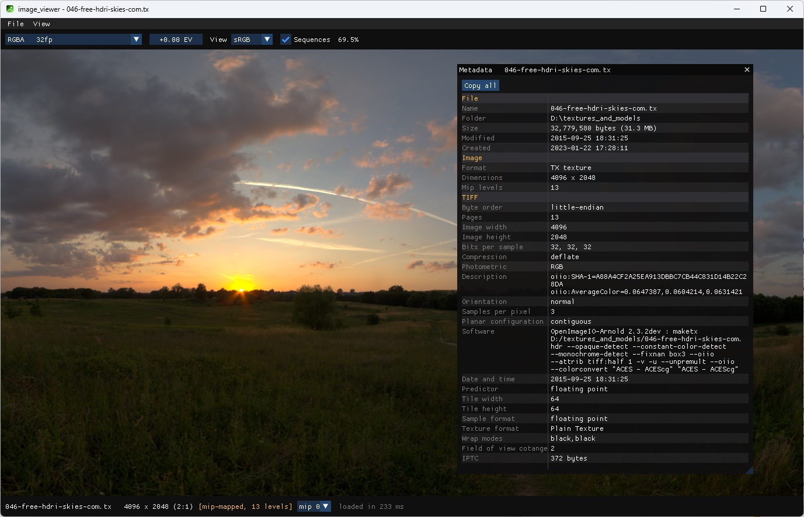

# image_viewer



My personal vibe-coded project to replace the old but fast ACDSee viewer for home use, and to bring proper **EXR** and **TX** support along the way.

It is built for **the lowest possible latency and fast sequence playback**: images appear the moment the file is decoded, the wheel steps through a folder without waiting, and cached sequences play at hundreds of frames per second. It assumes a GPU with DirectX 12 (Windows) or Vulkan (Linux, planned).

## Supported formats

| Format | Extensions | Notes |
|---|---|---|
| OpenEXR | `.exr` | multi-part, layers and single channels, all compressions incl. HTJ2K, tiled with mip levels |
| TX textures | `.tx` | maketx textures (TIFF or EXR inside), any mip level can be shown |
| TIFF | `.tif` `.tiff` | 8/16-bit integer, 16/32-bit float, multi-page, mip pyramids |
| Radiance HDR | `.hdr` | RGBE and XYZE |
| PNG | `.png` | 8 and 16 bit |
| JPEG | `.jpg` `.jpeg` | |
| HEIC / HEIF | `.heic` `.heif` | colour profiles, 8 to 16 bit |
| Canon RAW 3 | `.cr3` | shows the embedded full-size JPEG preview (no RAW development) |
| WebP | `.webp` | still and animated |
| GIF | `.gif` | still and animated |
| SVG | `.svg` | re-rendered sharp at every zoom |
| BMP, TGA | `.bmp` `.tga` | |
| Softimage PIC | `.pic` | 8 and 16 bit, all three encodings, alpha in its own channel packet |
| Icons, cursors | `.ico` `.cur` | every entry as a frame |

Numbered files in a folder open as a sequence with a timeline. Colour adjustments in floating windows: **Grade** reproducing Nuke's Grade node on the scene-linear values, and **Levels**, **Curves**, **Color Balance** and **Hue/Saturation** following GIMP's published maths on the displayed picture; they show live and go into Save As and Export. **Save As** writes EXR, HDR, PNG, JPEG, BMP, TGA, WebP, ICO and TIFF. **Export Video** writes a sequence or animation as it looks on screen to an MP4: H.265 or H.264 through the encoders Windows provides (the GPU's hardware encoder first), or AV1 through SVT-AV1 for the smallest files; no ffmpeg needed.

## Usage

- Open a file from the command line (`image_viewer.exe <file>`), by drag and drop, or through **File > Open**.
- **File icons and "open with":** run `image_viewer.exe --register` once (per user, no admin rights). Then right-click a file of each type, choose **Open with > Choose another app > image_viewer > Always**. Windows protects the default-app choice, so that one click per type has to be yours. `--unregister` removes everything again; after moving the exe, just run `--register` again.

## Controls

| Input | Action |
|---|---|
| Mouse wheel | next / previous image or sequence in the folder |
| Right drag | zoom |
| Middle drag | pan |
| Middle click, F11 | full screen (Esc leaves it) |
| F / H | fit / actual size |
| Space | play / pause a sequence |
| Left / Right, Home / End | step frames, first / last frame of the play range (set in the boxes at the timeline's ends or by dragging its brackets) |
| R | real-time playback (uncapped, every frame) |
| A | toggle ACES / sRGB view |
| Page Up / Page Down | previous / next channel (the wheel over the channel box works too) |
| I | metadata (EXIF, EXR header, ...) |
| E | export the sequence as an MP4 video |
| G | Grade window (Nuke's key) |
| Ctrl+L, Ctrl+M, Ctrl+B, Ctrl+U | Levels, Curves, Color Balance, Hue/Saturation windows (Photoshop's keys); Esc closes the focused one |
| Ctrl+O, Ctrl+Shift+S | open, save as |

## Building

### Windows

1. Install **Visual Studio 2026** (or its Build Tools) with the *Desktop development with C++* workload, the **C++ Clang Compiler for Windows** (clang-cl) component and a Windows SDK.
2. Install [vcpkg](https://github.com/microsoft/vcpkg) and point the `VCPKG` environment variable at it:

   ```bat
   git clone https://github.com/microsoft/vcpkg
   vcpkg\bootstrap-vcpkg.bat
   setx VCPKG "%CD%\vcpkg"
   ```

3. Install the libraries:

   ```bat
   vcpkg install openexr libjpeg-turbo libheif libwebp tiff[core,jpeg,lzma,zip,libdeflate] libdeflate lunasvg stb nativefiledialog-extended imgui[dx12-binding,win32-binding] svt-av1 --triplet x64-windows
   ```

4. Open `image_viewer.sln`, pick **Release | x64** and build, or from a developer prompt:

   ```bat
   msbuild image_viewer.sln -p:Configuration=Release -p:Platform=x64
   ```

   The result lands in `build\image_viewer.exe`; vcpkg copies the needed DLLs next to it. The CPU needs AVX2. The `dev` configuration is my development setup (same compiler and optimisations, everything written to a RAM disk); use Release.

**Optional speed-up.** Some libraries get faster when vcpkg builds them with clang-cl and AVX2 through an overlay triplet: OpenEXR's PIZ / B44 / DWA decoding by 11-27%, libdeflate and libtiff by a few percent. libde265 1.0.18 built by MSVC also crashes as soon as libheif loads it, so HEIC images need it built with clang-cl. Setting this up is out of scope here; an AI coding assistant can write the overlay triplet for you (clang-cl as the chainloaded toolchain with `/arch:AVX2` for libde265, libheif, openexr, libdeflate and tiff).

### Linux

Planned, with a Vulkan backend. Instructions will follow.

## Performance

The first working version simply called each library the documented way: OpenEXR's C++ API, stb_image, one GPU buffer created per frame, mostly single-threaded decoders. Every step since was measured, kept when it paid off and dropped when it did not. Measured on my machine (24 hardware threads, RTX 3090, PCIe 4.0):

| | first version | now |
|---|---|---|
| 8K Radiance HDR, decode | 650 ms | 22-30 ms |
| wheel step to the next 8K HDR / 4K EXR | ~1000 ms (8K HDR) | ~24 ms median (prefetched and uploaded ahead) |
| EXR 33.5 MP half RGB, uncompressed / RLE / ZIPS / ZIP | 70 / 67 / 52 / 27 ms | 18 / 25 / 23 / 18 ms |
| PNG 4K RGBA | 58 ms | 19 ms |
| TIFF 24 MP 16-bit deflate | 355 ms | 23 ms |
| HEIC 18 MP (iPhone) | 77 ms (Windows WIC: 544 ms) | 37 ms |
| CR3 full-size preview | 57 ms | 29 ms |
| folder with 20 000 files, sequence detection per open | ~1.5 s | 11 ms once, then cached |
| leaving a 4 GB cached sequence | 181 ms UI stall | none |
| first picture on screen after launch | after GPU start-up | 20-90 ms (GPU still starting) |

Cached playback runs at about 1300 fps for 1080p and 340 fps for 4K half-float frames, which is close to what PCIe 4.0 can move.

### Design points

- **Zero-copy streaming.** Decoders write straight into CPU-visible GPU memory (write-back heaps, buffers placed in pooled 512 MB heaps); the GPU copies from there. No intermediate buffers, no per-frame allocation.
- **Let the GPU expand pixels.** HDR stays RGBE, RGB stays 3-channel, and JPEG, CR3 previews and HEIC stay YCbCr planes; compute shaders convert them, bit-exact to libjpeg-turbo and libheif. Less memory traffic, and HEIC decoding halves.
- **Start-up hides the driver.** Creating a D3D12 device costs the NVIDIA driver 120-150 ms. The first image is decoded meanwhile and painted with GDI, so it is on screen in 20-90 ms; the decoded frame is then handed to the GPU without a copy.
- **Browsing never waits.** The next file in the wheel direction is decoded and uploaded to a spare texture in the background, so a wheel step only swaps textures. Loads are interruptible: fast scrolling cancels decodes nobody needs any more.
- **Display.** A full mip chain is built lazily on the GPU (Mitchell filter in linear light) for clean zoomed-out views; the swap chain goes through DirectComposition, which avoids desktop stalls under windowed G-SYNC.
- **Threads.** A small pool with dynamic chunking (an atomic chunk counter, a short spin, then an atomic wait) spreads every decoder over all cores; dispatching a loop costs 1.4 us. Big frees run on their own thread, so the UI never stalls on memory.
- **Sequences.** One folder scan groups numbered files into sequences (versions are split, gappy folders like camera photos are left as single images) and is cached until the folder changes.

### Libraries searched and evaluated

| Area | Compared | Chosen | Why |
|---|---|---|---|
| PNG | stb_image, Wuffs, libdeflate + own SSE2 unfiltering | libdeflate | 4K RGBA: 58 / 29 / 19 ms |
| EXR | OpenEXR C++ API, OpenEXR core (C) API | core API with own chunk-parallel AVX2 unpacking | the C++ API stopped scaling at 8 threads on 1-scanline codecs |
| HEIC | Windows WIC, libheif + libde265 | libheif | 544 vs 75-81 ms, then 37 ms with GPU YCbCr |
| JPEG | libjpeg-turbo RGB vs YCbCr output, clang-cl build | libjpeg-turbo, YCbCr planes to the GPU | 13-14% less CPU; clang-cl brought nothing (hand-written SIMD) |
| JPEG 2000 (HTJ2K) | OpenJPH vs libjpeg-turbo on the same picture | not used as a JPEG replacement | 2.2-4.6x slower to decode per thread, 37% smaller at equal quality |
| TIFF | libtiff with zlib / with libdeflate, fast-tiff-lib | libtiff + libdeflate, own raw tile decoding | 1.65-1.9x; fast-tiff-lib only lent the raw-tile idea |
| Reading files | memory mapping, overlapped reads | overlapped reads for EXR | the mapping page-faulted 4.6x slower at 24 threads |
| GPU memory | a committed buffer per frame, placed buffers in pooled heaps | pooled heaps | 6.5 ms to create and 3.5 ms to free per 66 MB, vs memory speed and 0.1 ms |
| Threading | Windows thread pool, threads per loop, own pool | own pool | dynamic chunks: +10% HDR, +30-35% TIFF over a static split; OpenMP ruled out on design grounds (idle threads spin, concurrent loops oversubscribe) |
| Presentation | HWND swap chain, DirectComposition swap chain | DirectComposition | the HWND chain stalled the whole desktop under windowed G-SYNC |

## License

[MIT](LICENSE). Written by Oleh Bliznuk and Claude (Anthropic).

The application icon comes from Microsoft's [Fluent UI System Icons](https://github.com/microsoft/fluentui-system-icons), also MIT ([notice](res/LICENSE-fluentui-system-icons.txt)). The libraries installed through vcpkg keep their own licences.
